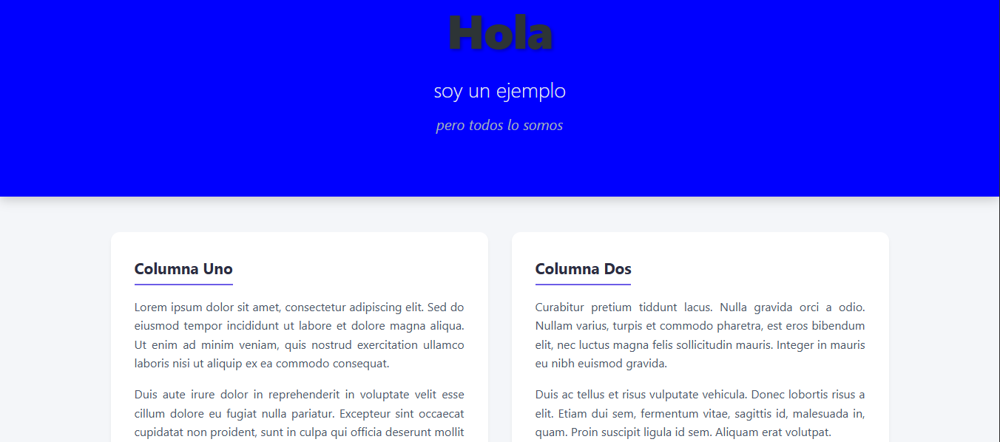
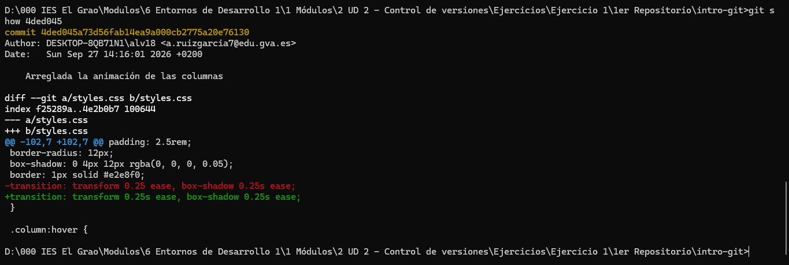

# Proyecto Intro Git - Nicolás Gustavo Ramos

Este es un proyecto de ejemplo para la asignatura de Entornos de Desarrollo.

## Estado anterior de la web
Aquí se muestra la web en un commit anterior:

## Diferencias en el commit 4ded045
Aquí se muestra qué se cambió exactamente en el commit de la animación:
