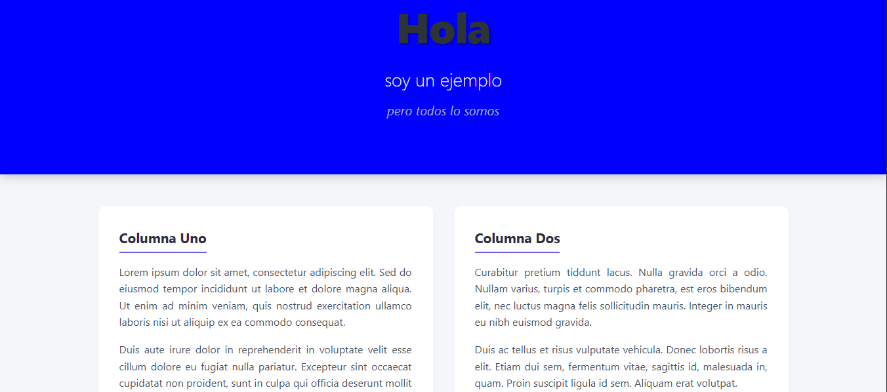
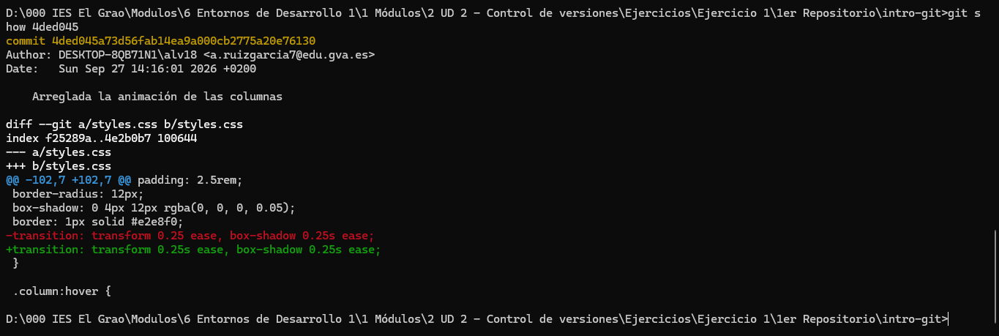
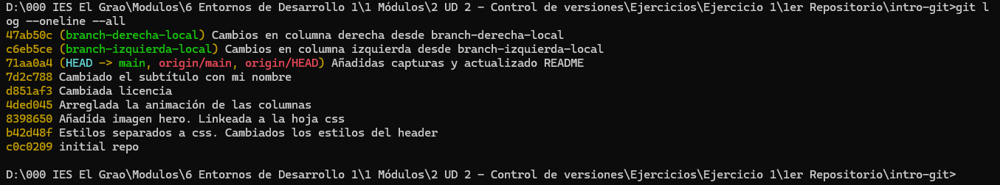
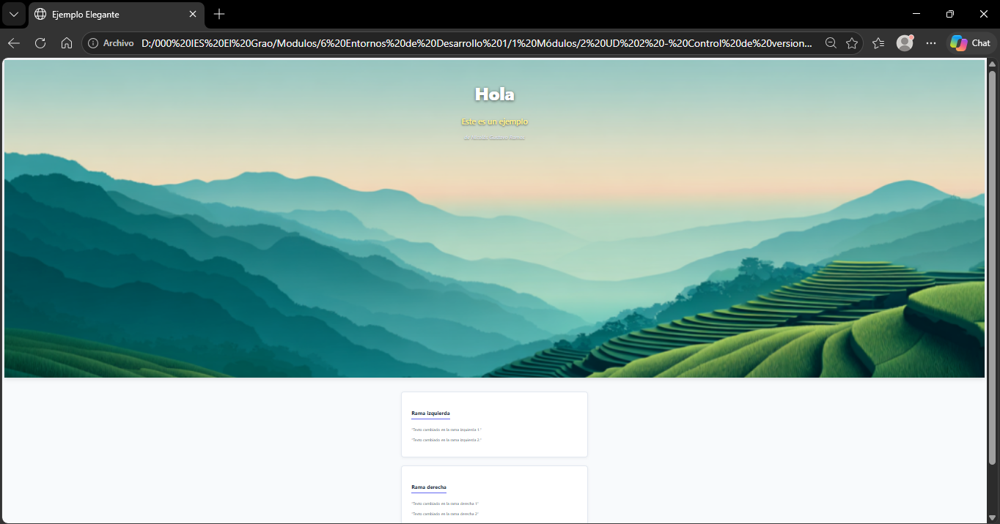

# Proyecto Intro Git - Nicolás Gustavo Ramos

Este es un proyecto de ejemplo para la asignatura de Entornos de Desarrollo, en el que se practica el control de versiones con Git.

## Estado anterior de la web
Aquí se muestra cómo era la web al hacer checkout a un commit anterior:

## Diferencias en el commit 4ded045
Aquí se muestra el cambio exacto realizado en la animación de las columnas:

## Captura de git log --oneline --all

## Captura de las dos columnas combinadas
